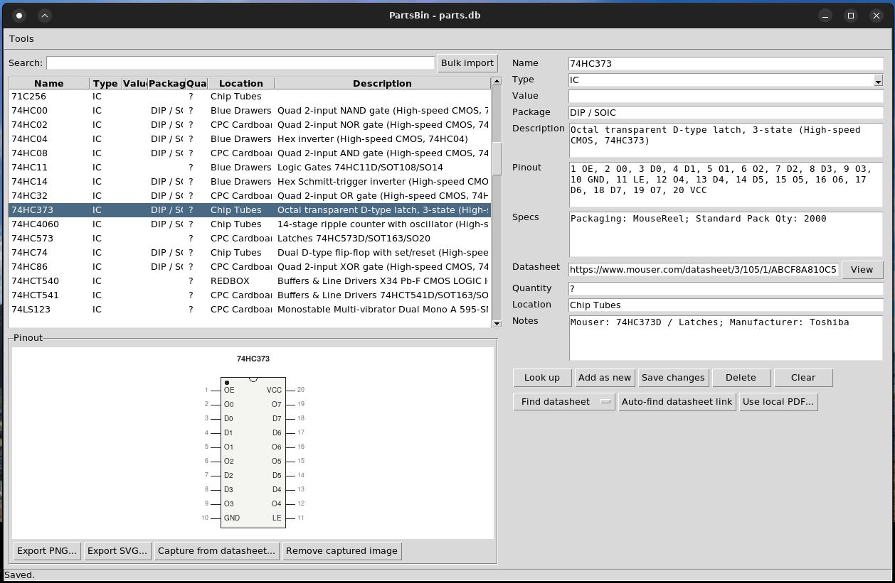
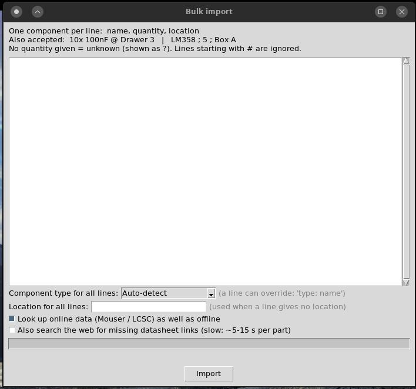

# PartsBin

A desktop catalogue of the electronic components in my drawers and boxes, because I got tired of never being able to find anything!
It is a Python + Tkinter application on top of a single SQLite file, and it runs on Linux and
Windows. Add parts one at a time or paste in a whole list, and PartsBin looks up the
type, value, description, pinout and datasheet for you.




## Features

- **Catalogue** of semiconductors and passives: name, type, value, package,
  description, pinout, specs, datasheet link, quantity, location and notes.
- **Automatic look-up** when you add a part (see [Where the data comes from](#where-the-data-comes-from)).
- **Bulk import** from a text box, with a type hint to keep the searches on target.
- **Unknown quantities**: parts you haven't counted yet are stored as `-1` and shown as `?`.
- **Pinout diagrams** drawn from the pinout text (DIP-style or in-line), with PNG and
  SVG export. If the generated diagram isn't good enough, you can capture the figure
  straight from the datasheet PDF and store it with the part.
- **Built-in datasheet viewer** with zoom and text search, for web links and local PDFs.
- **Datasheet finder** that searches the web and only accepts a PDF that really
  mentions the part number.
- **Sortable, searchable grid** of everything in stock.
- **Tools for tidying up**: assign locations to whole imports by date, and delete parts
  by location.

## Installing

You need Python 3.8 or later with Tkinter. PartsBin uses only the standard library,
apart from one optional package, PyMuPDF.

### Ubuntu / Debian

```
sudo apt install python3 python3-tk python3-fitz
```

| Package | Needed for |
|---------|------------|
| `python3` | Running the application (Python 3.8 or later) |
| `python3-tk` | The GUI. Tkinter is a separate package on Debian-based systems, and without it the program fails with `No module named 'tkinter'` |
| `python3-fitz` | Optional. This is PyMuPDF (the module is imported as `fitz`). I developed against version 1.19.2 from Ubuntu 22.04 |

`python3-fitz` is only needed for PNG export, capturing pinout figures from datasheets,
the built-in PDF viewer and verifying datasheets found by the web search. Everything
else works without it, and the app tells you when a feature needs it.

If you'd rather use pip than the Ubuntu package, install into a virtual environment.
Recent Ubuntu and Debian releases refuse system-wide `pip install`:

```
sudo apt install python3-venv python3-tk
python3 -m venv .venv
.venv/bin/pip install -r requirements.txt
.venv/bin/python partsbin.py
```

`python3-tk` still has to come from apt, because Tkinter can't be installed with pip.

### Windows

The python.org installer includes Tkinter. For the optional package, run
`pip install pymupdf`.

### Other Linux distributions

Install Python 3 with its Tkinter package (often `python3-tkinter` or `tk`) and, if
you want the PDF features, `pip install pymupdf` in a virtual environment.

## Running

```
python partsbin.py                  # uses parts.db next to the program
python partsbin.py /path/to/my.db   # or any other database file
```

The database is created on first run. Back it up by copying the file.

### Windows shortcut

Double-click `install_launcher.cmd` to add PartsBin to the Start menu, with its icon and
no console window. To also put a shortcut on the Desktop, or to remove the shortcuts,
run it from a terminal:

```
install_launcher.cmd -Desktop
install_launcher.cmd -Uninstall
```

It uses a `.venv` folder next to the program if there is one, otherwise `pythonw` or the
`py` launcher from your Python install. Run it again if you move PartsBin.

### Linux launcher

To start PartsBin from your applications menu, with its icon, run this once:

```
./install_launcher.sh              # add the launcher
./install_launcher.sh --uninstall  # remove it
```

It writes `~/.local/share/applications/partsbin.desktop` containing this folder's
absolute path, so run it again if you move PartsBin. If a `.venv` folder exists next to
the program, the launcher uses it. Otherwise it uses the system `python3`.

## Using it

### Adding a part

Type a name (for example `74HC595`, `LM358`, `10k`, `100nF`) in the form on the right
and click **Look up**. The empty fields are filled in. Check them, set the quantity and
location, then click **Add as new**. If the same name, value and location already exist,
the quantity is added to that row.

Selecting a row in the grid loads it into the form. **Save changes** updates it,
**Delete** removes it and **Clear** empties the form. The search box above the grid
matches any text field. Click a column heading to sort by it, and click again to
reverse.

### Bulk import

**Tools → Bulk import...** takes one component per line:

```
74HC595, 10, Drawer 3
10x 100nF @ Drawer 3
LM358 ; 5 ; Box A
NE555
Op-amp: TL072
# lines starting with # are ignored
```



- Fields can be separated by commas, semicolons or tabs. `10x name @ place` also works.
- **No quantity means unknown** (`?`), not 1, so you can import a list before counting.
- **Type for all lines** narrows the searches. Choosing *IC* stops `4043` from matching
  cable glands. A single line can override it with a `type:` prefix, as above.
- **Location for all lines** is used for lines that don't give their own. Imports are
  usually one drawer at a time.
- **Re-importing updates, it doesn't duplicate.** A part with the same name and value is
  updated even if its location differs: the new location and any quantity you give
  replace the old ones, empty fields are filled in, and existing data is kept.
- Optional: also search the web for missing datasheet links (slow, about 5 to 15 s per
  part).

### Pinouts

The pinout box holds the pin list as text (for example
`1 QB, 2 QC, ... 8 GND, ... 16 VCC`). The diagram under the grid is drawn from it. Use
**Export PNG...** or **Export SVG...** to save it.

If a part has no text pinout or the diagram looks wrong, use **Capture from
datasheet...**: PartsBin opens the datasheet, suggests the pages that look like a
pinout, and you drag a box round the figure. The cropped image is stored in the
database and shown instead of the generated diagram. **Remove** goes back to the
generated one.

### Datasheets

- **View** next to the Datasheet field opens the built-in viewer. If the link isn't a
  PDF, it falls back to your browser.
- **Find datasheet** opens a web search narrowed with the manufacturer part number and
  manufacturer from the Notes field. It also offers datasheetarchive.com and
  alldatasheet.com.
- **Auto-find datasheet link** does the search itself, downloads the candidates, and
  stores the first PDF that mentions the part. It never opens a browser.
- **Use local PDF...** points the part at a file you downloaded yourself and goes
  straight to capturing the pinout. Only the path is stored, so don't move the file.
  A captured image is kept in the database either way.

### Housekeeping

**Tools → Locations by import date...** groups parts by when they were added (rows added
within 10 minutes of each other count as one import). Select imports, type a location
and apply it. The lower half lists every location and lets you delete all parts at the
selected ones, after a confirmation. Deletes can't be undone.

## Where the data comes from

Sources are tried in this order, and the first source to supply a field wins:

1. **Built-in knowledge**: a small table of common parts, a decoder for 74xx and 4000
   logic names (`74HC4060`, `CD4017`, `HEF4538`), and a parser for passive values
   (`10k`, `4k7`, `100nF`). Works offline.
2. **LCSC / EasyEDA**, for LCSC part numbers such as `C2040`. No key needed.
3. **Mouser API**, for general parts. Needs a free API key. Results are filtered so that
   the manufacturer part number matches and the Mouser category fits the type, which
   avoids mismatches.
4. **KiCad symbol libraries**, for older and obsolete parts Mouser no longer lists. A
   snapshot of the official KiCad libraries is included as `kicad_index.db`, so the
   app doesn't depend on any KiCad installation. It provides descriptions, datasheet
   links and pinouts. The libraries are CC-BY-SA licensed.

To refresh the snapshot: `python partsbin.py --build-kicad-index` downloads the current
libraries from KiCad and rebuilds it. You can also pass a zip file or folder of
`.kicad_sym` files instead.

## Settings

**Tools → Settings...** holds two optional keys:

- **Mouser API key**: free from Mouser's account area. Without it, the offline sources,
  LCSC and KiCad are still used.
- **Serper API key**: used by the datasheet finder. Serper returns Google results and
  has a free tier. Without a key, the finder falls back to DuckDuckGo and Bing, which
  throttle automated searches, so it will often find nothing. If a search fails, the
  status bar says why.

Keys are stored in `partsbin_config.json` next to the program. That file is in
`.gitignore`, so it isn't committed.

## Limitations

- Look-ups are best effort. Check what was filled in, especially for obscure or
  obsolete parts. Some old parts aren't found by any source, and you can fill those in
  by hand.
- The datasheet finder depends on third-party search services that can change or
  block automated use.
- Where pins don't number cleanly 1 to N, or the part isn't a DIP or in-line package,
  the generated pinout diagram may not apply. Capture the figure from the datasheet
  instead.

## Files

| File | Purpose |
|------|---------|
| `partsbin.py` | The application: database, look-ups, GUI |
| `pinout.py` | Pinout diagrams, PNG/SVG export, datasheet capture and the PDF viewer |
| `datasheets.py` | Web search and verification for the datasheet finder |
| `icon.png`, `icon.ico` | Application icon (all platforms; Windows title bar and taskbar) |
| `install_launcher.sh` | Adds or removes the Linux applications-menu launcher |
| `install_launcher.ps1`, `install_launcher.cmd` | Adds or removes the Windows shortcuts (the `.cmd` is the double-click entry point) |
| `kicad_index.db` | Snapshot of the KiCad symbol libraries |
| `parts.db` | Your catalogue (created on first run; not committed) |
| `partsbin_config.json` | Your API keys (not committed) |

## Licence

MIT. See [LICENSE](LICENSE).
